# SSH Attack and Hardening Lab

I attacked my own Linux server over SSH, investigated the evidence in the logs, then hardened the server so the same attack no longer works. Everything was done in my own isolated VMware lab.

## Lab environment

| Machine | Role | IP | User |
| --- | --- | --- | --- |
| Router VM (self-built) | Client and "attacker"; gateway for the lab network | `172.19.201.1` | `cade` |
| Ubuntu Server 24.04 VM | Target server running OpenSSH | `172.19.201.3/27` | `student` |

Both VMs sit on an isolated VMware network (VMnet2). The router VM has two network adapters: one on NAT (the internet side) and one on VMnet2 (the lab side). The Ubuntu server only has a VMnet2 adapter, so all of its traffic goes through the router.

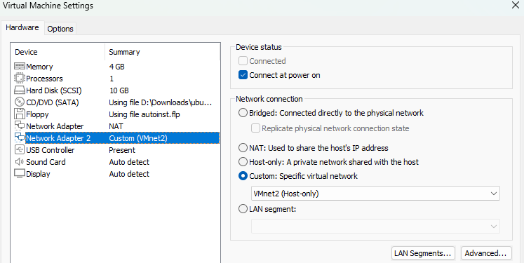
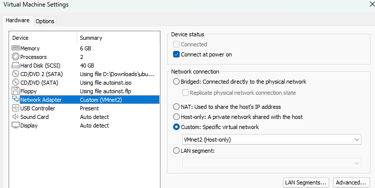
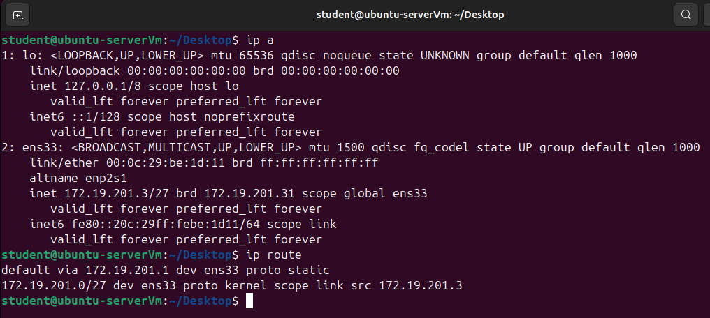

**Tools used:** OpenSSH, `grep`, `last`, `ufw`, `ssh-keygen`, `ssh-copy-id`, fail2ban, `apt`

## Part A: Attack and investigation

### The attack

SSH was installed on the server with password login allowed (Ubuntu's default).

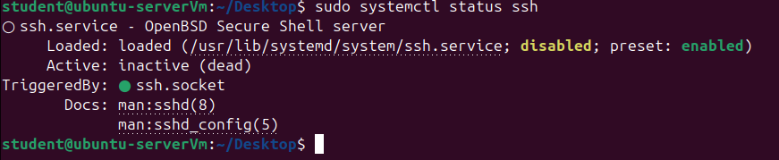

The service shows **inactive (dead)** even though SSH works. Ubuntu 24.04 uses **socket activation**: `ssh.socket` listens on port 22 and starts the SSH service only when a connection arrives.

From the router, I tried to log in with wrong passwords against a real account (`student`), a fake account (`fakeuser`), and `root`.

### Unexpected result: fail2ban blocked me first

I had already installed fail2ban, and on Ubuntu it protects SSH by default. After 5 bad attempts, it banned the router's IP, so my later attempts, including `root`, were refused before they reached SSH. That's why no `root` attempts appear in the logs.

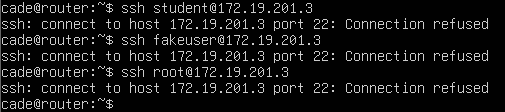
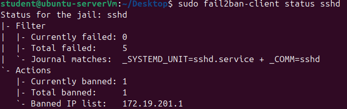

I unbanned the router and paused fail2ban to finish this part of the lab.

### Reading the evidence

I searched `/var/log/auth.log` for SSH activity:

```bash
sudo grep -a sshd /var/log/auth.log | grep -E "Failed|Invalid|Accepted"
```

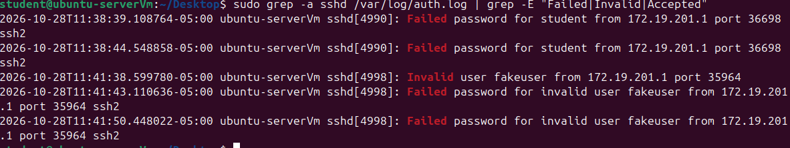

Example lines from the log:

```text
sshd[4990]: Failed password for student from 172.19.201.1 port 36698 ssh2
sshd[4998]: Invalid user fakeuser from 172.19.201.1 port 35964
sshd[4998]: Failed password for invalid user fakeuser from 172.19.201.1 port 35964 ssh2
```

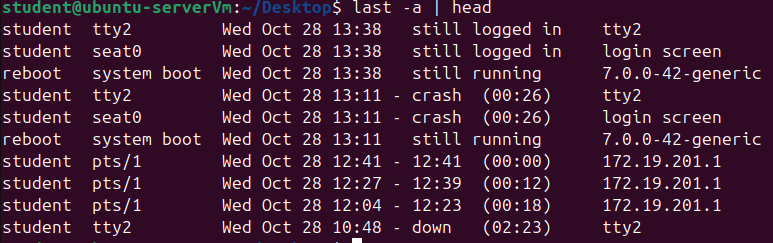

`last -a` shows the remote SSH sessions (`pts/1`) coming from the router at `172.19.201.1`, separate from local console sessions (`tty2`, `seat0`). It also records an unclean shutdown as `crash`, which on a real server would be worth investigating.

### Findings

- **5 bad events, all from `172.19.201.1`** (the router): 4 failed passwords and 1 invalid user. This matched fail2ban's default limit of 5, which explains the ban.
- **Ports 36698 and 35964 are the router's source ports**, not SSH's port. SSH listens on port 22. A new source port means a new connection, which is how I told the attempts apart. `ssh2` means SSH protocol version 2.
- **Real vs fake usernames are logged differently.** `Failed password for student` means the account exists; `Invalid user fakeuser` means it doesn't. An attacker who can tell the difference can find out which accounts are real and focus their guessing on them. This is called **user enumeration**.
- **Failed attempts followed by a successful login from the same IP** is the classic sign of a break-in. On a real server, I would:
  1. Kill the session and lock the account or reset the password.
  2. Block the attacker's IP.
  3. Preserve the logs as evidence.
  4. Check what the attacker did: `sudo` use, new users, new keys in `~/.ssh/authorized_keys`, and scheduled tasks.
  5. Fix the root cause (weak password login), which is what Part B does.

## Part B: Hardening

### 1. Firewall: allow SSH only from the lab network

```bash
sudo ufw allow from 172.19.201.0/27 to any port 22 proto tcp
sudo ufw enable
sudo ufw status numbered
```

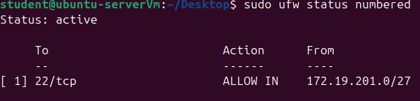

### 2. SSH key authentication

I generated a key pair **on the client** (the router) and installed the public key on the server.

```bash
ssh-keygen -t ed25519          # on the router
ssh-copy-id student@172.19.201.3
```

- `-t ed25519` selects a modern elliptic-curve algorithm: small keys, fast, and strong.
- The **private key** stays on the router and is protected with a passphrase. The server only holds the **public key** in `~/.ssh/authorized_keys`.
- The SHA256 value shown is the key's **fingerprint**, a hash of the public key. It's safe to share; the private key is never shown or shared.

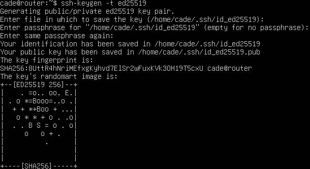

Logging in now asks for the key's passphrase instead of the server password:

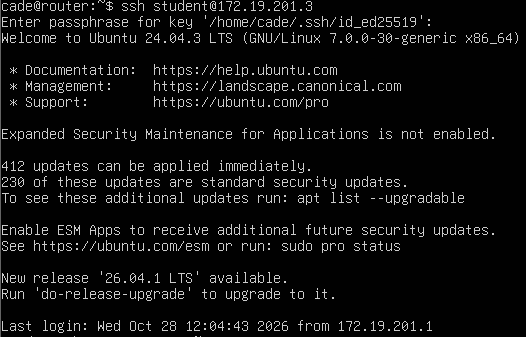

### 3. Disable password and root login

In `/etc/ssh/sshd_config`:

```text
PasswordAuthentication no
PermitRootLogin no
```

```bash
sudo sshd -t                   # check for config errors
sudo systemctl restart ssh
```

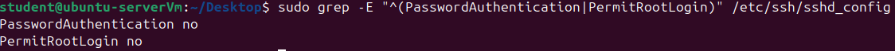

`PermitRootLogin no` is stricter than Ubuntu's default (`prohibit-password`, which still allows root with a key). Admins log in as themselves and use `sudo`, so every admin action is tied to a real user in the logs.

**Verification.** From the router, I forced a password attempt by telling SSH not to use my key:

```bash
ssh -o PubkeyAuthentication=no student@172.19.201.3
```

This simulates an attacker who doesn't have the private key. The server refused without even offering a password prompt:


### 4. fail2ban

`/etc/fail2ban/jail.local`:

```ini
[sshd]
enabled = true
maxretry = 3
bantime = 10m
```

To test it, I temporarily re-enabled password login, failed 3 times from the router, and the next connection was refused. `Permission denied (publickey,password)` confirms passwords were temporarily allowed for the test. I then unbanned the router and turned password login back off.

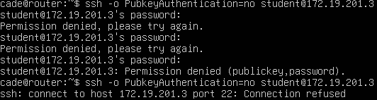
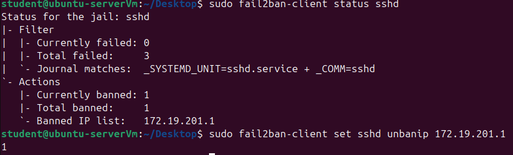

```bash
sudo fail2ban-client status sshd
sudo fail2ban-client set sshd unbanip 172.19.201.1
```

### 5. Patch management

The SSH login banner showed **412 pending updates, 230 of them security updates**. I took VM snapshots first, then applied them with `apt upgrade` (not `do-release-upgrade`, which would move to a new Ubuntu version).

```bash
sudo apt update && sudo apt upgrade -y
```

| | Pending updates |
| --- | --- |
| Before | 412 (230 security) |
| After | 0 |

The "before" numbers are in the login banner in the key login screenshot above. The update also installed a newer kernel: the banner showed `7.0.0-30-generic` before patching, and the `last -a` boot entries show `7.0.0-42-generic` after rebooting, confirming the patches took effect. Afterward, `apt-check` confirms nothing is pending:

```bash
/usr/lib/update-notifier/apt-check --human-readable
```

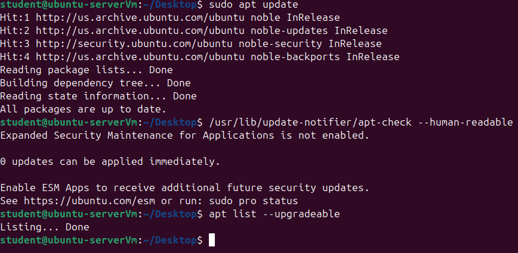

## Results: defense in depth

| Defense | What it stops |
| --- | --- |
| Firewall limited to `172.19.201.0/27` | Anyone outside the lab network can't reach SSH at all |
| Key-only login | Brute force, password spraying, and credential stuffing |
| Passphrase on the private key | A stolen key file is useless without it |
| `PermitRootLogin no` | Blocks the most targeted account and keeps admin actions accountable |
| fail2ban | Automated guessing is banned after 3 tries |
| Patching | Known vulnerabilities in installed software |

An attacker would now have to get past several layers instead of guessing one password.

## Troubleshooting and lessons learned

- **Network:** My Ubuntu VM had a static IP for the lab network. Switching its adapter to NAT left it with the wrong address for that network, so it couldn't connect. Keeping it on VMnet2 with the router VM running fixed it.
- **"Binary file matches":** `grep` found the log lines but wouldn't print them because `auth.log` contained non-text bytes. Adding `-a` forced grep to treat the file as text.
- **Key on the wrong machine:** I was still SSH'd into the server from the router and generated the key on the server by mistake (note `student@ubuntu-serverVm` in the prompt). Keys belong on the client, so I deleted it and generated it on the router. Lesson: always check the hostname in the prompt before running a command.

  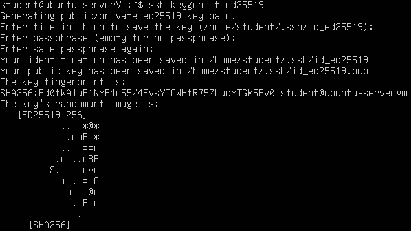
- **Early ban:** fail2ban was already protecting SSH by default and banned me mid-attack, which showed the defense working before I configured it.

## Disclaimer

All testing was done on virtual machines I own, in an isolated lab. Never test systems you don't have permission to test.
